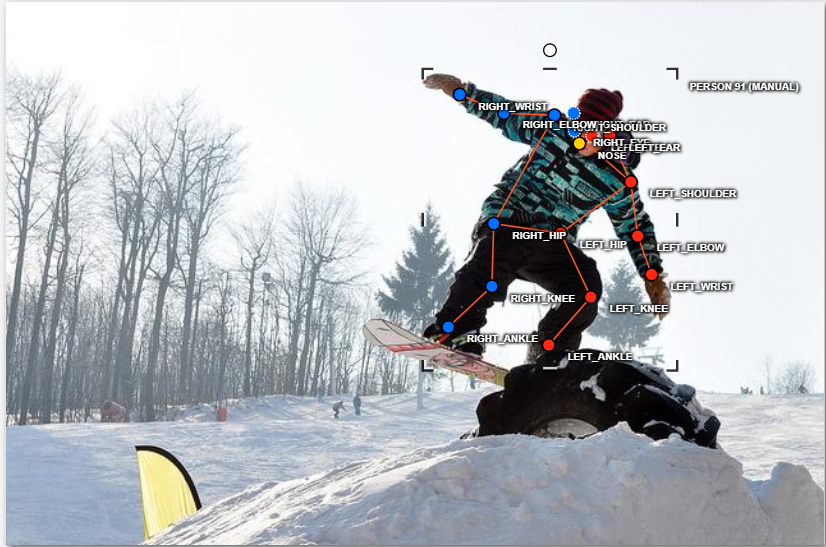
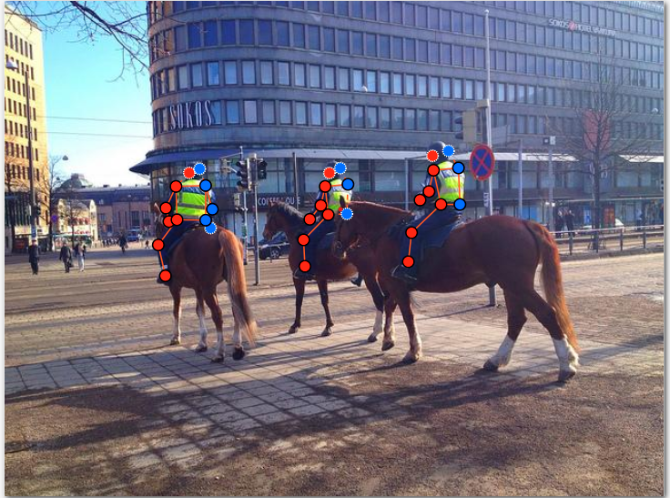
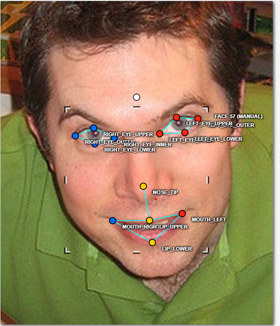
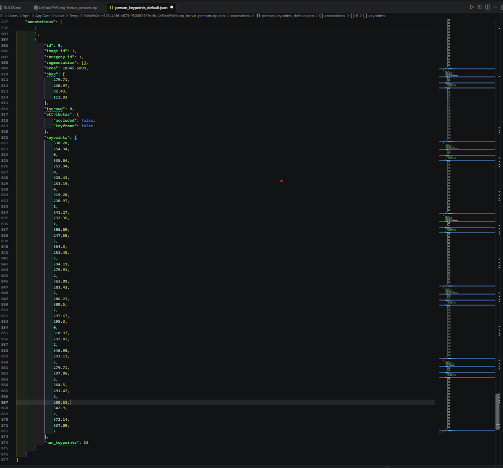

# Báo cáo cá nhân — HoVaTen-MSSV

Đổi tên file theo quy tắc `MSSV_HoTen.md`. Ví dụ: `20241234_NguyenVanAn.md`.

Dữ liệu: 12 ảnh người COCO val2017 (Lin et al., 2014) và 8 ảnh chân dung Wikimedia Commons, chỉ dùng trong lớp.

## 0. Thông tin học viên

- Họ tên: Lê Trần Phi Hùng
- Email: 26ai.hungltp@vinuni.edu.vn26ai.hungltp@vinuni.edu.vn
- Link repository: https://github.com/hung-1503/K5-L2B-DAY04-LeTranPhiHung-2A202603353-KeypointPose-Student
- Phiên bản CVAT (Help → About): 2.74.1
- Máy: hệ điều hành Window · RAM 16 GB · chạy CVAT chế độ đầy đủ
- Bộ ảnh (`src/exports/assignment.json` do `lab.py setup` tạo): có
- Giờ bắt đầu: 17h
- Giờ kết thúc: 23h

## 1. Kiểm tra label (CP0)

| Label | Kiểu | Số điểm | Tên điểm đúng bảng của lab? | Đúng thứ tự? | Số cạnh |
|---|---|---:|---|---|---:|
| `person` | Skeleton | 17 | Có | Có | 19 |
| `face` | Skeleton | 13 | Có | Có | 13 

Mẫu `person` dựng theo người quay mặt về camera (các điểm `left_*` nằm bên phải khung mẫu)? Có

Cách đổi cờ `occluded` / `outside` cho **một điểm** trên phiên bản CVAT này (một câu):

Chọn đúng skeleton, chọn điểm cần đổi cờ, rồi bật `occluded`(hoặc nhấn nút Q trên bàn phím) nếu điểm bị che nhưng vẫn ước lượng chắc; chọn `outside`(hoặc nhấn nút O trên bàn phím) nếu điểm ở ngoài ảnh hoặc không thể đoán chắc.

## 2. Số lượng đã gán và thời gian (CP1, CP2)

| Nhóm ảnh | Số ảnh | Số skeleton đã gán | Số người dưới 60 px (không gán) | Số poster / gương / màn hình bỏ qua | Thời gian (phút) |
|---|---:|---:|---:|---:|---:|
| `easy` | 5 | | 0 | 0 | 25 |
| `occluded` | 3 | | | | 15 |
| `back` | 2 | 6 | 0 | 0 | 16 |
| `small` | 1 | 1 | 0 | 0 | 5 |
| `crowd` | 1 | 3 | 7 | 0 | 14 |
| `faces` | 8 | 8 | — | 0 | 30 |

- Số ảnh người đã xong ở mốc phút 105: 9 / 10
- Thời gian thực tế (phút): CP1 120 · CP2 30 · CP3 20
- Ảnh tốn thời gian nhất là ảnh nào, vì sao?
Ảnh `000000375535.jpg` mất nhiều thời gian gán nhãn nhất vì có 3 người cần tạo Skeleton, trong đó hai người điều khiển mô tô bị che khuất phần lớn thân dưới. Việc xác định vị trí các khớp hông, đầu gối và cổ chân gặp nhiều khó khăn. Tôi phải quan sát kỹ từng người, phân biệt các keypoint có thể ước lượng chính xác để đặt `Occluded (v=1)` và các keypoint không thể xác định để đặt `Outside (v=0)`. Ngoài ra, tôi cần kiểm tra lại hướng trái/phải và đường nối giữa các khớp để tránh gán nhãn sai.

## 3. Bảng ca khó (CP1, CP2)

Mỗi điểm bạn phân vân một dòng, nhất là phân vân giữa `v = 1` và `v = 0`, hoặc không chắc hướng người.

| Ảnh | Người / mặt | Điểm | Cờ đã chọn | Phân vân giữa | Lý do chọn |
|---|---|---|---:|---|---|
 `000000375535.jpg` | Cảnh sát lái mô tô | `left_hip`, `right_hip` | v= | `v=1` / `v=0` | Phần hông bị mô tô che khuất, khó xác định chính xác vị trí khớp. |
| `000000269462.jpg` | Người cưỡi ngựa | `left_knee`, `right_knee` | v=0 | `v=1` / `v=0` | Chân bị thân ngựa che, khó ước lượng vị trí đầu gối. |
| `000000012552.jpg` | Người bắt bóng | `right_knee` | v=1 | `v=1` / `v=0` | Tư thế ngồi xổm khiến các khớp chân  chồng lấp, khó xác định vị trí chính xác. |

## 4. Bảng tự review (CP3)

Đi từ ảnh cuối về ảnh đầu. 5 ảnh người (ít nhất 2 ảnh `back` hoặc `crowd`) và 3 ảnh mặt. Ít nhất 8 dòng, kể cả dòng `ok`. Ghi lỗi trước, sửa sau.

Mã lỗi dùng đúng một trong: `lr_swap`, `vis_flag`, `position`, `missing`, `extra`, `ok`.

| Ảnh | Người / mặt | Điểm | Mã lỗi | Ghi chú | Đã sửa? |
|---|---|---|---|---|---|
| `000000012552.jpg` | Người | `left_shoulder`, `right_shoulder` | `position` | Hai điểm vai nằm ngược phía, cần kiểm tra hướng người để xác định có bị `lr_swap` hay không. | Chưa |
| `000000019754.jpg` | Người | `left_wrist`, `right_wrist` | `position` | Hai điểm cổ tay nằm ngược phía, có thể do tay bắt chéo hoặc nhầm trái/phải. | Chưa |
| `000000311497.jpg` | Người | `left_knee`, `right_knee` | `position` | Hai điểm đầu gối nằm ngược phía, cần kiểm tra tư thế chân. | Chưa |
| `000000311497.jpg` | Người | `left_ankle`, `right_ankle` | `position` | Hai điểm cổ chân nằm ngược phía, có thể do chân bắt chéo hoặc nhầm trái/phải. | Chưa |
| `000000176000.jpg.jpg`| Người| - | ok| Không có lỗi| Chưa|
| `face_300399.jpg.jpg`| Mặt| - | ok| Không có lỗi| Chưa|
| `face_362568.jpg.jpg`| Mặt| - | ok| Không có lỗi| Chưa|
| `face_421231.jpg.jpg`| Mặt| - | ok| Không có lỗi| Chưa|


Tổng hợp số lỗi theo mã:

| `lr_swap` | `vis_flag` | `position` | `missing` | `extra` | `ok` |
|---:|---:|---:|---:|---:|---:|
| 1 | 0 | 2 | 0 | 0 | 4 |

Điểm còn phân vân giữa `v = 1` và `v = 0` (ghi cả hai lựa chọn và lý do chọn):

- `000000012552.jpg`: Các khớp bị che khuất một phần. Cân nhắc `v=1` nếu có thể ước lượng vị trí dựa vào các khớp lân cận; chọn `v=0` nếu không đủ căn cứ xác định chính xác.
- `000000019754.jpg`: Vị trí cổ tay khó xác định do tay có thể bắt chéo hoặc bị che. Chọn `v=1` nếu xác định được vị trí cổ tay, ngược lại chọn `v=0`.
- `000000311497.jpg`: Đầu gối và cổ chân có thể bị che hoặc bắt chéo. Chọn `v=1` khi có thể ước lượng chắc chắn vị trí khớp; chọn `v=0` nếu không thể xác định đáng tin cậy.

## 5. Kiểm file xuất và kết quả tự kiểm (CP4)

Tự kiểm tay trong file JSON:

| File | Người / mặt kiểm (ảnh, thứ tự) | Số phần tử `keypoints` | Điểm `outside` ra `v = 0`, `occluded` ra `v = 1`? | `num_keypoints` khớp? |
|---|---|---:|---|---|
| `LeTranPhiHung_persons.zip` | `000000012552.jpg`, #1 | 51 | Theo script: `outside → v=0`, `occluded → v=1` | Theo script: khớp |
| `LeTranPhiHung_persons.zip` | `000000019754.jpg`, #1 | 51 | Theo script: `outside → v=0`, `occluded → v=1` | Theo script: khớp |
| `LeTranPhiHung_faces.zip` | `face_137371.jpg`, #1 | 39 | Theo script: `outside → v=0`, `occluded → v=1` | Theo script: khớp |

Sau khi xuất, CVAT ghi `occluded` thành `v = 1` và `outside` thành `v = 0`. Tọa độ của điểm `outside` trong file là tọa độ cũ; chuẩn COCO quy ước điểm `v = 0` là `0, 0`, nhưng script ghi chú đây không phải lỗi vì điểm bị bỏ qua khi huấn luyện và khi chấm.

Hai job đã chuyển sang completed trên CVAT? Có

Dán phần **TÓM TẮT** in ra từ `src/check_submission.py`:

```text
=== LeTranPhiHung_persons.zip (label `person`) ===
[CẢNH BÁO] 000000012552.jpg #1: cặp shoulder nằm ngược phía so với các cặp còn lại. Có thể đổi trái/phải một cặp (`lr_swap`), hoặc tay / chân bắt chéo thật: kiểm lại.
[CẢNH BÁO] 000000019754.jpg #1: cặp wrist nằm ngược phía so với các cặp còn lại. Có thể đổi trái/phải một cặp (`lr_swap`), hoặc tay / chân bắt chéo thật: kiểm lại.
[CẢNH BÁO] 000000311497.jpg #1: cặp knee, ankle nằm ngược phía so với các cặp còn lại. Có thể đổi trái/phải một cặp (`lr_swap`), hoặc tay / chân bắt chéo thật: kiểm lại.

File person: LeTranPhiHung_persons.zip
Số ảnh: 12 · số skeleton `person`: 22 · mỗi annotation 51 số
Cờ v: v=2 260 (70%) · v=1 53 (14%) · v=0 61 (16%)
num_keypoints trung bình: 14.2

File face: LeTranPhiHung_faces.zip
Số ảnh: 8 · số skeleton `face`: 8 · mỗi annotation 39 số
Cờ v: v=2 96 (92%) · v=1 8 (8%) · v=0 0 (0%)
num_keypoints trung bình: 13.0

Ghi chú: 61 điểm v = 0 vẫn mang tọa độ cũ (CVAT 2.x xuất như vậy; chuẩn COCO ghi 0, 0). Không phải lỗi: điểm v = 0 bị bỏ qua khi huấn luyện và khi chấm.
Số [LỖI]: 0 · số [CẢNH BÁO]: 3
```

Các `[CẢNH BÁO]` còn giữ nguyên và lý do:

- `000000012552.jpg` #1: `shoulder` nằm ngược phía; chưa kết luận là `lr_swap` hay tư thế/tay chân bắt chéo. Cần mở ảnh và kiểm tra trước khi sửa.
- `000000019754.jpg` #1: `wrist` nằm ngược phía; chưa kết luận là `lr_swap` hay tay bắt chéo. Cần mở ảnh và kiểm tra trước khi sửa.
- `000000311497.jpg` #1: `knee`, `ankle` nằm ngược phía; chưa kết luận là `lr_swap` hay chân bắt chéo. Cần mở ảnh và kiểm tra trước khi sửa.
```

## 6. Ảnh chụp màn hình

1. Label `person` trong label constructor (đủ 17 điểm có tên):

   

2. Một người quay lưng đã gán, cờ đã đặt:

   

3. Một khuôn mặt đã gán 13 điểm, phóng to vùng mắt:

   

4. Một đoạn JSON xuất của một người:

   

Nguồn ảnh: COCO val2017 / Wikimedia Commons.

## 7. Tự đánh giá

1. Lỗi bạn mắc nhiều nhất hôm nay, và cách bạn sẽ tránh ở dự án thật:

   Lỗi cần ưu tiên là kiểm tra trái/phải sau khi script cảnh báo `shoulder`, `wrist`, hoặc `knee/ankle` lệch cặp. Khi làm lại, cần xác định hướng người trước rồi kiểm tra các cặp đối xứng trước khi lưu.

2. Một quy tắc bạn đề xuất thêm vào guideline (kèm ảnh ví dụ nếu có):

   Đề xuất thêm một bước bắt buộc: sau khi đặt xong mỗi skeleton, bật tên điểm và kiểm tra riêng các cặp trái/phải từ vai đến cổ tay và từ hông đến cổ chân trước khi chuyển ảnh.

3. Nhãn của bạn đi vào model ở đâu? Chọn một lỗi bạn đã sửa và nói nó sẽ làm model học sai thế nào (heatmap, trọng số trong loss, hay bước lật ảnh):

   Nếu một cặp trái/phải bị đổi tên, tọa độ có thể vẫn nằm đúng vị trí cơ thể nhưng nhãn ngữ nghĩa sai. Model sẽ học heatmap của `left_*` và `right_*` ở hai phía ngược nhau; khi lật ảnh, lỗi còn bị khuếch đại do bước hoán đổi trái/phải.

## 8. Khó khăn và lỗi kỹ thuật

Khó khăn chính được thể hiện qua 3 cảnh báo trái/phải trong file `person`. Export không có `[LỖI]`; cần mở lại ba ảnh cảnh báo trên CVAT để quyết định đó là `lr_swap` hay tư thế tay/chân bắt chéo. Phiên bản CVAT, thời gian thao tác và trạng thái completed chưa được ghi nhận.

## Bonus (nếu làm)

### B1 — 3 ảnh người khó thêm

| Ảnh | Số skeleton | Số người dưới 60 px | Ca khó nhất |
|---|---:|---:|---|
| `000000125998.jpg` | 3 | 0 | chưa ghi nhận |
| `000000188948.jpg` | 3 | 0 | chưa ghi nhận |
| `000000323525.jpg` | 3 | 0 | chưa ghi nhận |

Kết quả kiểm đếm file `LeTranPhiHung_bonus_persons.zip`:

```text
ZIP có 3 ảnh, 9 skeleton `person`, mỗi annotation 51 số. Phân bổ: `000000125998.jpg=3`, `000000188948.jpg=3`, `000000323525.jpg=3`. Không có kết quả chạy `check_submission.py` bonus riêng trong dữ liệu được cung cấp.
```

### B2 — 5 ảnh khuôn mặt đen trắng / hồng ngoại

Ảnh không màu khó hơn ở điểm nào? Kính râm trên ảnh hồng ngoại có còn là `v = 1` không?

Ảnh không màu làm mất các dấu hiệu màu hỗ trợ phân biệt mắt, môi, da và kính; vì vậy cần dựa nhiều hơn vào biên hình học và vị trí tương đối. Kính râm vẫn là `v = 1` nếu mắt bị che nhưng vị trí mắt còn được ước lượng chắc; nếu không thể đoán thì dùng `v = 0`.


### B3 — Model so với nhãn của tôi (không tính điểm)

- **Demo đã dùng:** Skycally Face Landmarks (https://skycally.com/tools/face-landmarks).
- **Ảnh đã thử:** face_296417.jpg.

**1. Model có trả điểm cho khớp bị che, hay khớp ngoài ảnh không? Confidence ở các điểm đó thế nào?**

Model vẫn dự đoán các landmark trên khuôn mặt, kể cả vùng bị ria mép che một phần. Tuy nhiên, demo không hiển thị confidence cho từng điểm nên chưa thể đánh giá độ tin cậy. Chưa kiểm tra khớp nằm ngoài ảnh.

**2. Với người quay lưng, model có đổi trái/phải không?**

Chưa kiểm tra ảnh người quay lưng nên chưa thể kết luận model có nhầm trái/phải hay không.

**3. Bộ điểm của model có giống 17 điểm COCO không?**

Không. Demo Face Landmarks dự đoán nhiều điểm trên khuôn mặt, trong khi COCO Pose sử dụng 17 keypoint trên cơ thể. Bộ điểm này cũng khác với 13 keypoint khuôn mặt được gán trong CVAT.

## 9. Tài liệu tham khảo và công cụ AI đã dùng

- **Tài liệu tham khảo:**
  - `docs/GUIDELINE.md`: Hướng dẫn quy trình và quy tắc gán nhãn.
  - `docs/COCO_KEYPOINTS.md`: Tham khảo vị trí và thứ tự 17 keypoint COCO.
  - `RULES.md`: Quy định thực hiện và nộp bài.

- **Công cụ sử dụng:**
  - **CVAT:** Gán nhãn và xuất dữ liệu Skeleton.
  - **Skycally Face Landmarks:** Dự đoán landmark khuôn mặt để so sánh với nhãn thủ công trong CP2.
  - **ChatGPT:** Hỗ trợ giải thích kết quả script, phân tích các trường hợp khó và trình bày báo cáo Markdown.

**Cam kết:** Toàn bộ nhãn được thực hiện trên CVAT. Dữ liệu JSON được export trực tiếp, không chỉnh sửa thủ công. AI chỉ được sử dụng để tham khảo, phân tích và hỗ trợ viết báo cáo.

